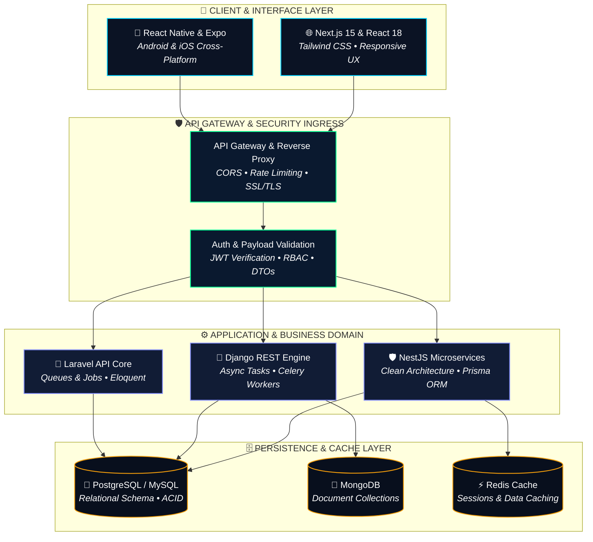

<!-- ═══════════════════════════════════════════════════════════════
     YIHUNE BELAY — Full-Stack Software Engineer & Mobile Developer
     Ultra-Modern & Creative GitHub Profile
═══════════════════════════════════════════════════════════════ -->

<div align="center">

<!-- ANIMATED CYBER HERO BANNER -->
<a href="https://yihune-software.vercel.app/" target="_blank">
  
</a>

<br/><br/>

<!-- DYNAMIC TYPING SVG -->
<a href="https://github.com/yihune1234">
  
</a>

<br/><br/>

<!-- QUICK ACTION HUD BADGES -->
[](https://yihune-software.vercel.app/)
&nbsp;
[](mailto:yihunebelay859@gmail.com)
&nbsp;
[](https://github.com/yihune1234)
&nbsp;
[](https://github.com/yihune1234)

<br/>

[](https://github.com/yihune1234)

</div>

<br/>

---

### 💻 &nbsp;Interactive Developer Console

<div align="center">
  
</div>

<br/>

---

### 👨‍💻 &nbsp;About Me & Engineering DNA

<table width="100%" border="0" cellpadding="10" cellspacing="0">
  <tr>
    <td width="180" align="center" valign="middle">
      
      <br/><br/>
      <a href="https://yihune-software.vercel.app/" target="_blank">
        
      </a>
    </td>
    <td width="20"></td>
    <td valign="top">
      <h4>Hey there, I'm Yihune Belay Sebsibe! 👋</h4>
      <p>I am a passionate <strong>Full-Stack Software Engineer &amp; Mobile App Developer</strong> graduating with a B.Sc. in <strong>Software Engineering from Haramaya University</strong>. I specialize in turning complex specifications into scalable, production-ready web platforms and cross-platform mobile apps.</p>
      <ul>
        <li>🎯 <strong>Engineering Philosophy:</strong> Clean code, strict type safety, modular services, and high runtime performance.</li>
        <li>💡 <strong>Modern Frontend:</strong> Next.js 15, React 18, TypeScript, and Tailwind CSS for snappy, responsive interfaces.</li>
        <li>📱 <strong>Cross-Platform Mobile:</strong> React Native &amp; Expo with offline caching and native performance.</li>
        <li>🛡️ <strong>Robust Backends:</strong> NestJS Clean Architecture, Django REST Framework, Node.js, and Laravel.</li>
        <li>🌍 <strong>Work Preference:</strong> Open to <strong>Full-Time Roles</strong>, <strong>Contract Engineering</strong>, and <strong>Remote Collaboration</strong> globally.</li>
      </ul>
    </td>
  </tr>
</table>

<br/>

---

### 🌟 &nbsp;Flagship Projects & Production Systems

<table width="100%" border="0" cellpadding="12" cellspacing="0">
  <tr>
    <td width="50%" valign="top" style="border: 1px solid #1E293B; border-radius: 8px; background: #0A0E1A;">
      <h3>🏢 <a href="https://github.com/yihune1234/InternshipApplicantManagementAPI">Internship Applicant Management REST API</a></h3>
      <p>Production-grade backend built with <strong>Clean Architecture</strong>. Features JWT authentication, Prisma ORM, role-based access control (RBAC), data validation with class-validator, SQLite/PostgreSQL persistence, and interactive Swagger OpenAPI documentation.</p>
      <p>
        
        
        
        
        
      </p>
      <p><a href="https://github.com/yihune1234/InternshipApplicantManagementAPI"><strong>Explore Repository ➔</strong></a></p>
    </td>
    <td width="50%" valign="top" style="border: 1px solid #1E293B; border-radius: 8px; background: #0A0E1A;">
      <h3>🌐 <a href="https://yihune-software.vercel.app/">Developer Portfolio &amp; Project Showcase</a></h3>
      <p>Modern developer web application featuring dynamic project showcases, smooth animations, responsive glassmorphic interfaces, interactive contact forms, and automated CI/CD deployments via Vercel.</p>
      <p>
        
        
        
        
      </p>
      <p><a href="https://yihune-software.vercel.app/"><strong>View Live Website ➔</strong></a></p>
    </td>
  </tr>
  <tr>
    <td width="50%" valign="top" style="border: 1px solid #1E293B; border-radius: 8px; background: #0A0E1A;">
      <h3>📱 <a href="https://github.com/yihune1234/aritii_rider_app">Aritii Rider — Cross-Platform Mobility App</a></h3>
      <p>High-performance mobile application engineered for ride-hailing and urban delivery dispatch. Built with React Native and Expo, incorporating geospatial location tracking, real-time map updates, and optimized state handling.</p>
      <p>
        
        
        
        
      </p>
      <p><a href="https://github.com/yihune1234/aritii_rider_app"><strong>Explore Repository ➔</strong></a></p>
    </td>
    <td width="50%" valign="top" style="border: 1px solid #1E293B; border-radius: 8px; background: #0A0E1A;">
      <h3>🗄️ <a href="https://github.com/yihune1234/Student-Contact-Management-System">Student Contact &amp; Records Management</a></h3>
      <p>Full-stack relational data platform handling academic records, student inquiry logs, contact categorization, secure session authentication, and transactional SQL data processing.</p>
      <p>
        
        
        
        
      </p>
      <p><a href="https://github.com/yihune1234/Student-Contact-Management-System"><strong>Explore Repository ➔</strong></a></p>
    </td>
  </tr>
</table>

<br/>

---

### 🛠️ &nbsp;Tech Arsenal & Capabilities

<table width="100%" border="0" cellpadding="12" cellspacing="0">
  <tr>
    <td width="50%" valign="top" style="border: 1px solid #1E293B; border-radius: 8px; background: #0A0E1A;">
      <h4>💻 Languages &amp; Core Foundations</h4>
      <p>
        
        
        
        
        
        
        
      </p>
      <p><em>Focus: Strict Type Safety • Asynchronous Concurrency • Functional &amp; OOP Design • Clean Code Practices</em></p>
    </td>
    <td width="50%" valign="top" style="border: 1px solid #1E293B; border-radius: 8px; background: #0A0E1A;">
      <h4>🌐 Web Frontend Engineering</h4>
      <p>
        
        
        
        
        
      </p>
      <p><em>Focus: Server Components &amp; SSR • Responsive Design Systems • Fluid Micro-Interactions • State Architecture</em></p>
    </td>
  </tr>
  <tr>
    <td width="50%" valign="top" style="border: 1px solid #1E293B; border-radius: 8px; background: #0A0E1A;">
      <h4>📱 Mobile App Architecture</h4>
      <p>
        
        
        
        
      </p>
      <p><em>Focus: Cross-Platform Native Apps • 60 FPS Fluid Navigation • Offline-First SQLite • Native Sensor &amp; Map APIs</em></p>
    </td>
    <td width="50%" valign="top" style="border: 1px solid #1E293B; border-radius: 8px; background: #0A0E1A;">
      <h4>⚙️ Backend &amp; Microservices</h4>
      <p>
        
        
        
        
        
        
      </p>
      <p><em>Focus: Clean Modular Architecture • RESTful APIs • JWT &amp; Role-Based Access Control • Swagger/OpenAPI Specs</em></p>
    </td>
  </tr>
  <tr>
    <td width="50%" valign="top" style="border: 1px solid #1E293B; border-radius: 8px; background: #0A0E1A;">
      <h4>🗄️ Database Systems &amp; ORMs</h4>
      <p>
        
        
        
        
        
      </p>
      <p><em>Focus: Schema Normalization • Query Indexing &amp; Optimization • ACID Guarantees • NoSQL Collections</em></p>
    </td>
    <td width="50%" valign="top" style="border: 1px solid #1E293B; border-radius: 8px; background: #0A0E1A;">
      <h4>🔧 DevOps, Cloud &amp; Tooling</h4>
      <p>
        
        
        
        
        
        
      </p>
      <p><em>Focus: Multi-Stage Containerization • Automated CI/CD Pipelines • Server Hardening • Automated Testing</em></p>
    </td>
  </tr>
</table>

<br/>

---

### 🏗️ &nbsp;Full-Stack Architectural Flow



<div align="center">

```
 ┌──────────────────────────────────────────────────────────────────────────┐
 │                  END-TO-END REQUEST LIFECYCLE PATTERN                    │
 │                                                                          │
 │  1. CLIENT INGRESS  ───► Type-Safe Request (Next.js App / React Native)  │
 │  2. GATEWAY & AUTH  ───► JWT Verification, Rate-Limiting & DTO Validation │
 │  3. DOMAIN SERVICE  ───► Clean Business Logic, Services & Event Handling │
 │  4. PERSISTENCE     ───► Prisma ORM / SQL Transactions + Redis Caching   │
 │                                                                          │
 │     🔒 Security-First   ⚡ Scalable Design   🧩 Modular Clean Code       │
 └──────────────────────────────────────────────────────────────────────────┘
```

</div>

<br/>

---

### 📊 &nbsp;GitHub Analytics & Live Activity

<div align="center">

<!-- AT A GLANCE METRICS COUNTER -->
<table width="100%" border="0" cellpadding="8" cellspacing="0">
  <tr>
    <td width="25%" align="center" style="border: 1px solid #1E293B; border-radius: 8px; background: #0A0E1A;">
      <h3 style="color:#00FF94; margin:0;">20+</h3>
      <p style="margin:4px 0 0; color:#94A3B8; font-size:12px;">Repositories &amp; Systems</p>
    </td>
    <td width="25%" align="center" style="border: 1px solid #1E293B; border-radius: 8px; background: #0A0E1A;">
      <h3 style="color:#00D2FF; margin:0;">4+</h3>
      <p style="margin:4px 0 0; color:#94A3B8; font-size:12px;">Backend Frameworks</p>
    </td>
    <td width="25%" align="center" style="border: 1px solid #1E293B; border-radius: 8px; background: #0A0E1A;">
      <h3 style="color:#FACC15; margin:0;">100%</h3>
      <p style="margin:4px 0 0; color:#94A3B8; font-size:12px;">Type-Safe Codebases</p>
    </td>
    <td width="25%" align="center" style="border: 1px solid #1E293B; border-radius: 8px; background: #0A0E1A;">
      <h3 style="color:#FF4F5E; margin:0;">⚡ Live</h3>
      <p style="margin:4px 0 0; color:#94A3B8; font-size:12px;">Open to Opportunities</p>
    </td>
  </tr>
</table>

<br/>

<!-- DUAL STATS CARDS -->
<table border="0" cellpadding="0" cellspacing="0">
  <tr>
    <td valign="top" align="center">
      
    </td>
    <td width="20"></td>
    <td valign="top" align="center">
      
    </td>
  </tr>
</table>

<br/>

<!-- STREAK STATS -->


</div>

<br/>

---

### 🎯 &nbsp;Current Focus & 2026 Engineering Goals

<table width="100%" border="0" cellpadding="12" cellspacing="0">
  <tr>
    <td width="50%" valign="top" style="border: 1px solid #1E293B; border-radius: 8px; background: #0A0E1A;">
      <h4>📱 Track 1: Next-Gen Mobile Architecture</h4>
      <p>
        
        &nbsp;
        <code>█████████░</code>
      </p>
      <ul>
        <li><strong>React Native New Architecture:</strong> Deep integration with Fabric renderer and TurboModules leveraging native C++ JSI bindings.</li>
        <li><strong>Offline-First Resilience:</strong> Client-side caching and delta data reconciliation via SQLite &amp; WatermelonDB.</li>
        <li><strong>Mobile Telemetry:</strong> Native push notification pipelines (Expo/FCM), deep-linking routing, and fluid gestures.</li>
      </ul>
    </td>
    <td width="50%" valign="top" style="border: 1px solid #1E293B; border-radius: 8px; background: #0A0E1A;">
      <h4>🛡️ Track 2: Enterprise Backend &amp; Microservices</h4>
      <p>
        
        &nbsp;
        <code>████████░░</code>
      </p>
      <ul>
        <li><strong>Clean Architecture &amp; NestJS:</strong> Domain-Driven Design (DDD), CQRS patterns, and decoupled dependency injection.</li>
        <li><strong>Asynchronous Message Queues:</strong> Event-driven communication with Redis Streams, Celery distributed tasks, and RabbitMQ.</li>
        <li><strong>Contract-First API Design:</strong> Interactive Swagger/OpenAPI v3 specifications, strict DTO validation, and automated client generation.</li>
      </ul>
    </td>
  </tr>
  <tr>
    <td width="50%" valign="top" style="border: 1px solid #1E293B; border-radius: 8px; background: #0A0E1A;">
      <h4>☁️ Track 3: Cloud Native, DevOps &amp; CI/CD</h4>
      <p>
        
        &nbsp;
        <code>████████░░</code>
      </p>
      <ul>
        <li><strong>Containerization:</strong> Multi-stage Docker builds optimized for minimal production image footprint and zero-leak secrets.</li>
        <li><strong>Automated Workflows:</strong> GitHub Actions CI/CD pipelines enforcing linting, type-checking, Jest testing, and automated deployment.</li>
        <li><strong>Production Infrastructure:</strong> Linux server hardening, Nginx reverse proxy configuration, and SSL/TLS automation.</li>
      </ul>
    </td>
    <td width="50%" valign="top" style="border: 1px solid #1E293B; border-radius: 8px; background: #0A0E1A;">
      <h4>⚡ Track 4: Performance &amp; Database Optimization</h4>
      <p>
        
        &nbsp;
        <code>███████░░░</code>
      </p>
      <ul>
        <li><strong>Query Execution Plans:</strong> Profiling and indexing with <code>EXPLAIN ANALYZE</code> in PostgreSQL/MySQL to eliminate N+1 bottlenecks.</li>
        <li><strong>Multi-Tier Caching:</strong> In-memory Redis caching layers with intelligent TTL invalidation strategies.</li>
        <li><strong>Modern Web Vitals:</strong> Next.js 15 Server Components, streaming SSR, and edge compute performance tuning.</li>
      </ul>
    </td>
  </tr>
</table>

<br/>

---

### 🤝 &nbsp;Let's Connect & Build Something Extraordinary

<div align="center">

<p>I am actively available for <strong>Full-Stack Engineer</strong>, <strong>Backend Developer</strong>, and <strong>Mobile Developer</strong> opportunities.</p>

<br/>

[](https://yihune-software.vercel.app/)
&nbsp;&nbsp;
[](mailto:yihunebelay859@gmail.com)
&nbsp;&nbsp;
[](https://github.com/yihune1234)

<br/><br/>

```
  ┌────────────────────────────────────────────────────────────┐
  │  📍 Location  │  Addis Ababa, Ethiopia  (EAT — UTC+3)     │
  │  💼 Status    │  Available for Freelance & Full-time Roles │
  │  🌐 Work Mode │  Remote-Ready                             │
  │  ⚡ Response  │  Within 24 hours                           │
  └────────────────────────────────────────────────────────────┘
```

<br/>

> *"Good software is crafted with passion, shaped by architecture, and refined by empathy for the user."* ✨

<br/>

<!-- ANIMATED FOOTER WAVE -->


</div>
