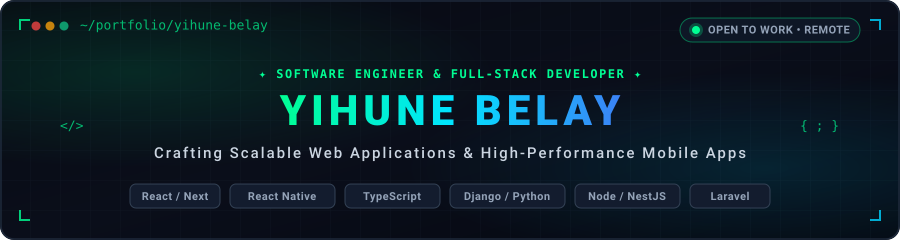
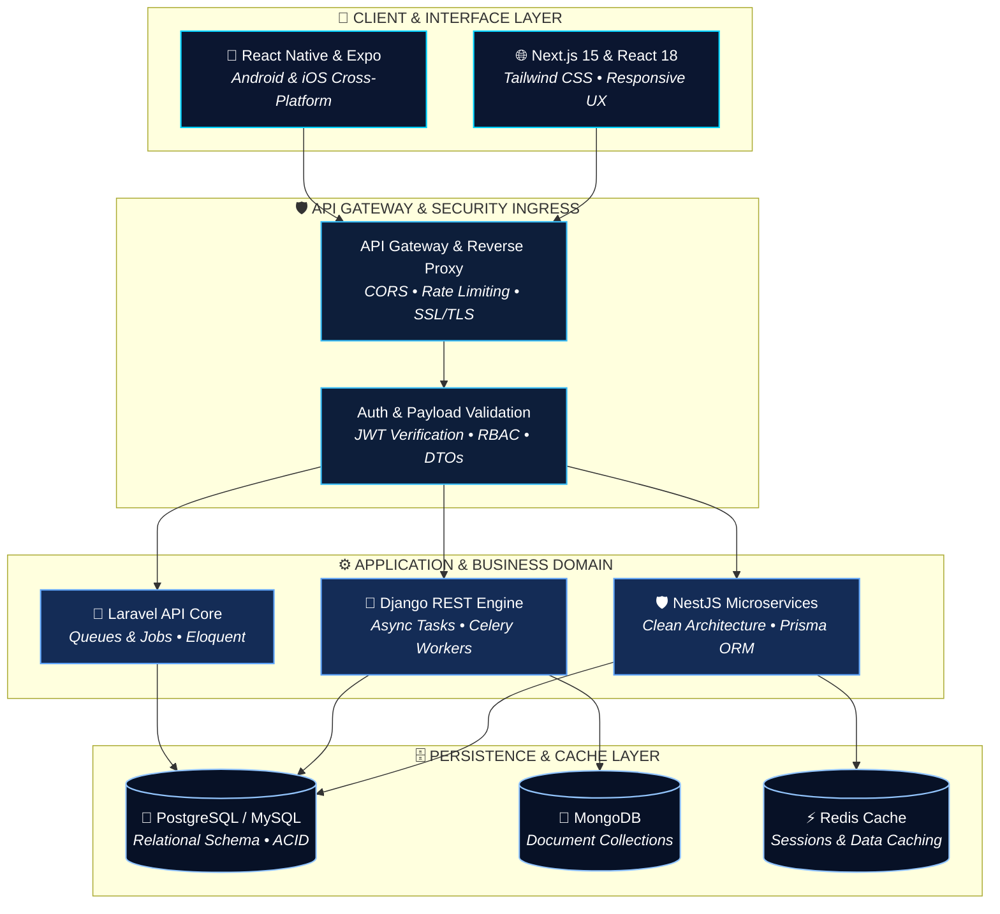
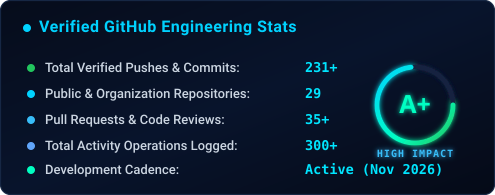
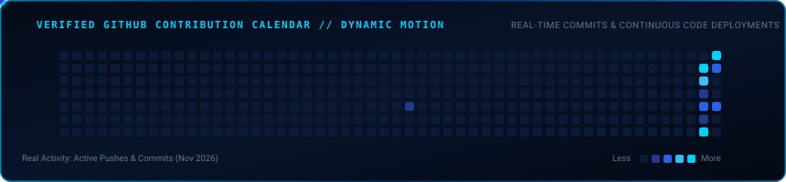

<!-- ═══════════════════════════════════════════════════════════════
     YIHUNE BELAY — Software Engineer | Full-Stack Developer | Technology Entrepreneur
     Brand Identity: Premium Dark Navy & Electric Blue
═══════════════════════════════════════════════════════════════ -->

<!-- HERO BANNER -->

  

<!-- DYNAMIC TYPING SVG -->

  

<!-- QUICK ACTION HUD BADGES -->

&nbsp;

&nbsp;

&nbsp;

 

 

---

### 💻 &nbsp;Interactive Developer Console

  

 

---

### 👨‍💻 &nbsp;Executive Summary & Engineering DNA

<table width="100%" border="0" cellpadding="12" cellspacing="0">
  <tr>
    <td width="180" align="center" valign="middle">
      
        
      
    </td>
    <td width="20"></td>
    <td valign="top">
      <h4>Yihune Belay Sebsibe</h4>
      
<strong>Software Engineer | Full-Stack Developer | Technology Entrepreneur</strong> based in Addis Ababa, Ethiopia 🇪🇹. Completing a B.Sc. in <strong>Software Engineering from Haramaya University</strong> and leading engineering initiatives as the Founder of <strong>Ariiti Technologies</strong>.

      <ul>
        <li>🚀 <strong>System Architecture:</strong> Specialized in designing high-throughput backend microservices, modular clean architectures, and type-safe full-stack platforms.</li>
        <li>📱 <strong>Cross-Platform Mobile:</strong> Engineering production mobile applications using React Native and Expo with native sensor integration and offline caching.</li>
        <li>🛡️ <strong>Core Philosophy:</strong> Strict type safety, clean domain-driven architecture, resilient APIs, and verifiable performance.</li>
        <li>🌐 <strong>Ventures:</strong> Building <a href="https://github.com/AriitiTech"><strong>Ariiti Technologies</strong></a> — digital commerce, enterprise management tools, and IT infrastructure solutions.</li>
      </ul>
    </td>
  </tr>
</table>

 

---

### 🌟 &nbsp;Featured Engineering Projects

<table width="100%" border="0" cellpadding="12" cellspacing="0">
  <tr>
    <td width="50%" valign="top" style="border: 1px solid #162E56; border-radius: 8px; background: #071126;">
      <h3>🏢 <a href="https://github.com/AriitiTech/Ariiti-Market-Project-Submission">Ariiti Market Platform Ecosystem</a></h3>
      
<em>Company Venture / Flagship System</em>

      
A multi-vendor digital commerce ecosystem connecting buyers, merchants, delivery riders, and platform administrators. Built with microservices architecture, React 18, Vite, TypeScript, and React Native mobile applications.

      

        
        
        
        
      

      
<a href="https://github.com/AriitiTech/Ariiti-Market-Project-Submission"><strong>Explore Central Project Hub ➔</strong></a>

    </td>
    <td width="50%" valign="top" style="border: 1px solid #162E56; border-radius: 8px; background: #071126;">
      <h3>🛡️ <a href="https://github.com/yihune1234/InternshipApplicantManagementAPI">Internship Applicant Management REST API</a></h3>
      
<em>Personal Engineering / Production Backend</em>

      
Production-ready RESTful backend following <strong>Clean Architecture</strong>. Implements stateless JWT authentication, Prisma ORM, role-based access control (RBAC), DTO validation, and Swagger/OpenAPI documentation.

      

        
        
        
        
      

      
<a href="https://github.com/yihune1234/InternshipApplicantManagementAPI"><strong>Explore API Repository ➔</strong></a>

    </td>
  </tr>
  <tr>
    <td width="50%" valign="top" style="border: 1px solid #162E56; border-radius: 8px; background: #071126;">
      <h3>📦 <a href="https://github.com/yihune1234/Stock-Management-System">Enterprise Stock &amp; Inventory System</a></h3>
      
<em>Personal Engineering / Full-Stack Data System</em>

      
Production stock tracking and inventory platform built with Node.js, Express, and Prisma ORM on PostgreSQL. Manages production batching, warehouse stock adjustments, automated receipts, and relational data integrity.

      

        
        
        
        
      

      
<a href="https://github.com/yihune1234/Stock-Management-System"><strong>Explore Inventory Repository ➔</strong></a>

    </td>
    <td width="50%" valign="top" style="border: 1px solid #162E56; border-radius: 8px; background: #071126;">
      <h3>🌐 <a href="https://myportfolio-1-01m7.onrender.com/">Interactive Developer Portfolio</a></h3>
      
<em>Personal Brand / Deployed Web Application</em>

      
Modern developer web platform engineered with TypeScript, React, responsive layouts, interactive project showcases, direct inquiry integration, and production hosting on Render.

      

        
        
        
        
      

      
<a href="https://myportfolio-1-01m7.onrender.com/"><strong>View Live Website ➔</strong></a>

    </td>
  </tr>
</table>

 

---

### 🛠️ &nbsp;Technical Competencies & Stack

<table width="100%" border="0" cellpadding="12" cellspacing="0">
  <tr>
    <td width="50%" valign="top" style="border: 1px solid #162E56; border-radius: 8px; background: #071126;">
      <h4>💻 Languages &amp; Core Foundations</h4>
      

        
        
        
        
        
        
        
      

      
<em>Strengths: Strict Type Safety • Asynchronous Concurrency • Clean Code • Functional &amp; OOP Patterns</em>

    </td>
    <td width="50%" valign="top" style="border: 1px solid #162E56; border-radius: 8px; background: #071126;">
      <h4>🌐 Web Frontend Engineering</h4>
      

        
        
        
        
        
      

      
<em>Strengths: Server Components &amp; SSR • Responsive Design • Fluid Micro-Interactions • State Architecture</em>

    </td>
  </tr>
  <tr>
    <td width="50%" valign="top" style="border: 1px solid #162E56; border-radius: 8px; background: #071126;">
      <h4>📱 Mobile App Architecture</h4>
      

        
        
        
        
      

      
<em>Strengths: Cross-Platform Native Apps • 60 FPS Fluid Navigation • Offline SQLite • Geospatial Sensor APIs</em>

    </td>
    <td width="50%" valign="top" style="border: 1px solid #162E56; border-radius: 8px; background: #071126;">
      <h4>⚙️ Backend &amp; Microservices</h4>
      

        
        
        
        
        
        
      

      
<em>Strengths: Clean Architecture • RESTful APIs • JWT &amp; Role-Based Access Control • Swagger/OpenAPI</em>

    </td>
  </tr>
  <tr>
    <td width="50%" valign="top" style="border: 1px solid #162E56; border-radius: 8px; background: #071126;">
      <h4>🗄️ Database Systems &amp; ORMs</h4>
      

        
        
        
        
        
      

      
<em>Strengths: Schema Normalization • Query Indexing &amp; Optimization • ACID Guarantees • NoSQL Collections</em>

    </td>
    <td width="50%" valign="top" style="border: 1px solid #162E56; border-radius: 8px; background: #071126;">
      <h4>🔧 DevOps, Cloud &amp; Tooling</h4>
      

        
        
        
        
        
        
      

      
<em>Strengths: Multi-Stage Containerization • Automated CI/CD Pipelines • Server Hardening • Automated Testing</em>

    </td>
  </tr>
</table>

 

---

### 🏗️ &nbsp;Full-Stack Architectural Flow

 

---

### 📊 &nbsp;GitHub Analytics & Live Activity

<!-- AT A GLANCE METRICS COUNTER -->
<table width="100%" border="0" cellpadding="8" cellspacing="0">
  <tr>
    <td width="25%" align="center" style="border: 1px solid #162E56; border-radius: 8px; background: #071126;">
      <h3 style="color:#00D2FF; margin:0;">25+</h3>
      
Active Repositories

    </td>
    <td width="25%" align="center" style="border: 1px solid #162E56; border-radius: 8px; background: #071126;">
      <h3 style="color:#38BDF8; margin:0;">4+</h3>
      
Backend Frameworks

    </td>
    <td width="25%" align="center" style="border: 1px solid #162E56; border-radius: 8px; background: #071126;">
      <h3 style="color:#60A5FA; margin:0;">100%</h3>
      
Type-Safe Codebases

    </td>
    <td width="25%" align="center" style="border: 1px solid #162E56; border-radius: 8px; background: #071126;">
      <h3 style="color:#00D2FF; margin:0;">⚡ Live</h3>
      
Open to Opportunities

    </td>
  </tr>
</table>

 

<!-- DUAL STATS CARDS -->
<table border="0" cellpadding="0" cellspacing="0">
  <tr>
    <td valign="top" align="center">
      
    </td>
    <td width="20"></td>
    <td valign="top" align="center">
      
    </td>
  </tr>
</table>

  

<!-- GITHUB CONTRIBUTION HEATMAP (RESPONSIVE WRAPPER) -->

  

 

---

### 🎯 &nbsp;Current Focus & 2026 Engineering Goals

<table width="100%" border="0" cellpadding="12" cellspacing="0">
  <tr>
    <td width="50%" valign="top" style="border: 1px solid #162E56; border-radius: 8px; background: #071126;">
      <h4>📱 Track 1: Next-Gen Mobile Architecture</h4>
      

        
        &nbsp;
        <code>█████████░</code>
      

      <ul>
        <li><strong>React Native New Architecture:</strong> Fabric renderer &amp; TurboModules integration using native C++ JSI bindings.</li>
        <li><strong>Offline-First Resilience:</strong> Client-side caching &amp; delta reconciliation via SQLite and local storage.</li>
        <li><strong>Mobile Telemetry:</strong> Native push notifications (Expo/FCM), deep-linking schemes, and gesture navigation.</li>
      </ul>
    </td>
    <td width="50%" valign="top" style="border: 1px solid #162E56; border-radius: 8px; background: #071126;">
      <h4>🛡️ Track 2: Enterprise Backend &amp; Microservices</h4>
      

        
        &nbsp;
        <code>████████░░</code>
      

      <ul>
        <li><strong>Clean Architecture &amp; NestJS:</strong> Domain-Driven Design (DDD), CQRS patterns, and decoupled dependency injection.</li>
        <li><strong>Asynchronous Message Queues:</strong> Event-driven communication with Redis Streams, Celery workers, and RabbitMQ.</li>
        <li><strong>Contract-First API Design:</strong> Complete Swagger/OpenAPI v3 specs, strict DTO validation, and automated client SDKs.</li>
      </ul>
    </td>
  </tr>
  <tr>
    <td width="50%" valign="top" style="border: 1px solid #162E56; border-radius: 8px; background: #071126;">
      <h4>☁️ Track 3: Cloud Native, DevOps &amp; CI/CD</h4>
      

        
        &nbsp;
        <code>████████░░</code>
      

      <ul>
        <li><strong>Containerization:</strong> Multi-stage Docker builds optimized for minimal production footprint and zero-leak secrets.</li>
        <li><strong>Automated Workflows:</strong> GitHub Actions CI/CD pipelines enforcing linting, type-checking, Jest testing, and automated deployment.</li>
        <li><strong>Production Infrastructure:</strong> Linux server hardening, Nginx reverse proxy configuration, and SSL/TLS automation.</li>
      </ul>
    </td>
    <td width="50%" valign="top" style="border: 1px solid #162E56; border-radius: 8px; background: #071126;">
      <h4>⚡ Track 4: Performance &amp; Database Optimization</h4>
      

        
        &nbsp;
        <code>███████░░░</code>
      

      <ul>
        <li><strong>Query Execution Plans:</strong> Profiling and indexing with <code>EXPLAIN ANALYZE</code> in PostgreSQL/MySQL to eliminate N+1 bottlenecks.</li>
        <li><strong>Multi-Tier Caching:</strong> In-memory Redis caching layers with intelligent TTL invalidation strategies.</li>
        <li><strong>Modern Web Vitals:</strong> Next.js 15 Server Components, streaming SSR, and edge compute performance tuning.</li>
      </ul>
    </td>
  </tr>
</table>

 

---

### 🤝 &nbsp;Connect & Collaborate

I am open to discussions regarding <strong>Software Engineering Roles</strong>, <strong>Enterprise Consulting</strong>, and <strong>Technology Partnerships</strong> through Ariiti Technologies.

 

&nbsp;&nbsp;

&nbsp;&nbsp;

&nbsp;&nbsp;

  

> *"Turning complex system challenges into elegant, resilient software architectures that deliver real-world impact."* ⚡

 

<!-- ANIMATED FOOTER WAVE -->

